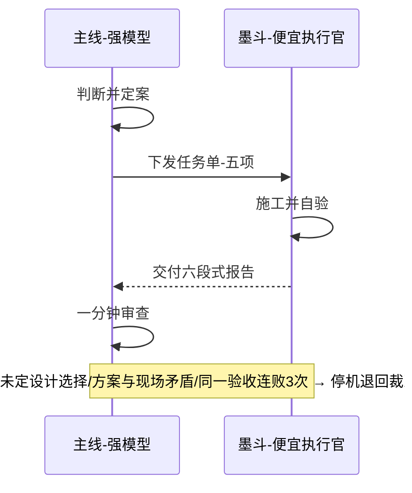
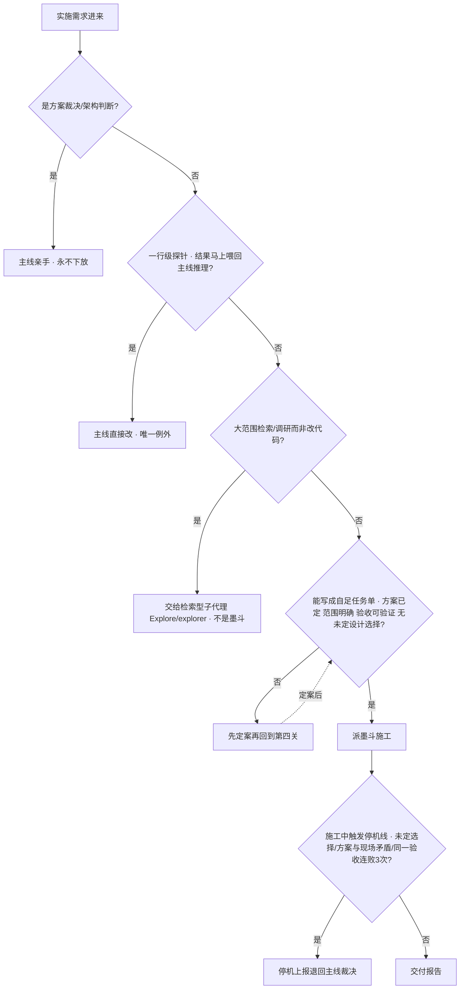

# 墨斗 Mòdǒu — 双模型执行官（Claude Code + Codex）

**Modou — A Dual-Model Executor Agent for Claude Code and OpenAI Codex CLI**

[中文](#中文) | [English](#english)

> 源自 [qq77666766-byte/modou](https://github.com/qq77666766-byte/modou)（原作者的 Claude Code 版），本仓库在其基础上扩展了 Codex 支持。许可证：待定（与上游一致）。

---

<a id="中文"></a>

## 中文

主线用强模型做**判断与定案**，所有已定案的实施（改代码、写新代码、跑测试/构建、批量修改、长文档）自动下沉给**更便宜的执行官**——单价低，而且实施过程不污染主线上下文。

**名字由来**：墨斗是木匠弹线定位的工具。主线弹线，工匠照线施工。

| | Claude Code | Codex CLI |
|---|---|---|
| 执行官定义 | `.claude/agents/executor.md`（子代理 `executor`） | `.codex/agents/modou.toml`（自定义 agent `modou`） |
| 怎么触发委派 | 子代理 description，Claude Code 自动委派 | **`AGENTS.md` 里的墨斗分流规则**（Codex 本地默认不主动委派，必须有它） |
| 推荐主线 → 执行官 | **Fable → Opus**（没有 Fable 时按可用的更强非 Mythos 系列；执行官必要时落到 Sonnet/Haiku） | **Sol → Luna**（Luna 不可用时落到 Terra） |
| 模型写法 | 系列别名 `opus` / `sonnet` / `haiku`，Claude Code 自动取该系列最新版 | 安装时按系列查询本机 `codex debug models`，写入该系列最新 id |

### 工作原理



主线只消费一份紧凑报告，实施过程的全部读文件、改代码、跑测试都发生在墨斗的独立上下文里。

### 判断树（两个平台相同）



另一条硬规则：**执行官必须明显便宜于主线**。主线与执行官同级（例如主线也是 Opus 或 Luna）时不委派——同级转包纯增开销；安装器和管理后台都会对这种配对报警。

### 安装：把仓库交给 Agent 自动集成（推荐）

在你的项目里打开 Claude Code 或 Codex，说一句：

> 读 `/path/to/modou` 的 README，把墨斗以项目级安装集成到当前项目，并跑自检。

Agent 会执行下面两条命令（你也可以自己跑）：

```bash
bash /path/to/modou/install.sh --project .          # 检测到 Claude Code / Codex 就分别装上
bash /path/to/modou/install.sh --check --project .  # 自检，全部 ✓ 才算就位
```

装完**新开一个会话**才生效（agent 列表在会话启动时加载）。

> **Codex 沙箱提示**：Codex 默认的 `workspace-write` 沙箱会保护项目里的 `.codex/` 目录（和 `.git/` 一样不让写），所以让 Codex 自己执行项目级安装时，它需要你**批准提权运行**这条命令；非交互的 `codex exec` 需要 `-s danger-full-access` 才能装。也可以直接在普通终端里运行上面的 `install.sh`。安装器遇到这种情况会报"没有写权限"并给出提示，不会留下半装状态。

### 安装：命令行选项

| 命令 | 作用 |
|---|---|
| `bash install.sh --project DIR` | 项目级：写 `DIR/.claude/agents/executor.md`、`DIR/.codex/agents/modou.toml`，并在 `DIR/AGENTS.md` 增改墨斗区块 |
| `bash install.sh` / `--user` | 用户级：写 `$CLAUDE_CONFIG_DIR`（默认 `~/.claude`）`/agents/executor.md`、`$CODEX_HOME`（默认 `~/.codex`）`/agents/modou.toml` 和 `~/.codex/AGENTS.md` 的墨斗区块 |
| `--claude` / `--codex` | 只装某一个平台（都不加 = 检测到哪个装哪个） |
| `--claude-executor-family opus\|sonnet\|haiku` | 指定 Claude 执行官系列（默认自动：比主线便宜的首选系列） |
| `--codex-executor-family luna\|terra` | 指定 Codex 执行官系列（默认 luna） |
| `--check` | 健康检查：文件、必需字段、名字冲突、配对、是否有更新的同系列模型、AGENTS.md 区块 |
| `--dry-run` | 只显示将做什么 |
| `--uninstall` | 卸载（先备份；AGENTS.md 只删墨斗区块） |

安全约定：

- 覆盖或修改任何已有文件前先备份到 `~/.local/state/modou/backups/<时间戳>/`（可用 `MODOU_BACKUP_DIR` 改），**备份不落在项目目录里**。
- 内容没变就不写、不备份——脚本可以反复运行。
- `AGENTS.md` 只增改 `<!-- modou:begin -->…<!-- modou:end -->` 区块，你自己的内容原样保留。
- 不修改 `~/.claude/settings.json`、`~/.codex/config.toml`（只读取主线模型做配对检查）。

手动安装也行：Claude Code 把 `agents/executor.md` 复制到 `.claude/agents/`；Codex 把 `agents/codex/modou.toml` 复制到 `.codex/agents/`，并把 `integrations/codex/AGENTS.snippet.md` 的内容贴进项目 `AGENTS.md`。注意手动复制的 `modou.toml` 没有 `model` 行，墨斗会继承主线模型（省上下文但不省钱），所以推荐用 `install.sh`。

### 系列，而不是钉死版本

- 选择逻辑只认**系列**：Claude 侧 `fable / opus / sonnet / haiku`，Codex 侧 `astra / sol / terra / luna`。
- Claude Code：agent 定义里直接写别名 `model: opus`，Claude Code 自己解析到当前账号下该系列的最新版。
- Codex：custom agent 的 `model` 需要具体 id，所以安装器在**安装时**跑 `codex debug models`（读不到再看 `~/.codex/models_cache.json`），从 `visibility=list` 的模型里挑该系列版本号最大的写进**已安装的** `modou.toml`。仓库里的模板不含任何版本号。Codex 升级出了新版本后重跑 `install.sh`（或 `--check` 会提示）即可。
- 价格表（`core/modou_models.py` 的 `PRICES`）保留具体 id 只为对账；没见过的新 id（例如将来的 `claude-opus-6-1`、`gpt-7-luna`）按名字归一到系列，并按该系列已知最新价估价，不会因为"不认识"而失败。
- **Mythos 不参与任何选择**：不在下拉框、不做自动主线、不做推荐。

查看本机解析结果：

```bash
python3 core/modou_models.py codex-models          # 本机 Codex 可用模型及系列
python3 core/modou_models.py recommend codex       # 主线/执行官推荐 + 配对检查
python3 core/modou_models.py recommend claude --main fable
```

### Codex 专项说明

- **为什么必须有 AGENTS.md**：本地 Codex 不会像 Claude Code 那样按 description 主动委派；只有用户直接要求，或 `AGENTS.md` / skill 明确要求时才会 spawn 子代理。墨斗区块就是这份明确要求：满足"方案已定、范围明确、验收可验证、无未定设计选择"时必须 spawn `modou`；方案裁决、架构判断、一行级探针、大范围调研不下放。
- **`fork_turns = "none"`**：Codex 的全量 fork 会继承主线模型、忽略 agent 文件里的 model。墨斗区块要求主线以 `fork_turns="none"` 派发，这样墨斗才真正跑在 Luna 上，而且只认任务单。
- **名字**：custom agent 叫 `modou`，刻意避开 Codex 内置的 `default` / `worker` / `explorer`（同名会覆盖内置 agent）。
- **effort**：官方建议显式使用 Luna 时 reasoning effort 从 `high` 起步，安装器默认这样写；Luna 单价约为 Sol 的 1/20，`high` 依然很便宜。
- 子代理继承主线的 sandbox 与审批设置（官方规定，agent 文件里改不了）。用 `/subagents` 可以查看和切换子代理线程。
- `codex exec` 非交互运行时请加 `</dev/null`，否则它会等待 stdin。

### 验证

**Codex**：在装好的项目里新开会话，丢一个小实施任务，例如：

> 在 /tmp/t 写个 hello.py 并跑通。

然后看 `/subagents`，或者看本机线程记录，应能看到一个 `agent_role = modou`、模型为 Luna 系列的子代理线程：

```bash
sqlite3 ~/.codex/state_5.sqlite \
  "select agent_role, model, tokens_used from threads where thread_source='subagent' order by created_at desc limit 5"
```

**Claude Code**：同样丢一个小实施任务，观察主线是否出现对 `executor` 的 Task/Agent 调用（模型为 Opus 系列）。

管理后台（见下）也能按身份统计墨斗的调用与费用。

### 任务单协议

主线下发的任务单必须写全五项——墨斗不继承主线记忆，任务单是唯一信息通道：

| # | 项 | 内容 |
|---|---|---|
| 1 | 已定方案 | 做什么、怎么做（裁决结果，不可偏离） |
| 2 | 范围 | 涉及的文件/模块 + 明确不许碰的部分 |
| 3 | 验收标准 | 哪些测试要过、lint 干净、行为描述 |
| 4 | 相关文件路径 | 精确到路径 |
| 5 | 验证命令与环境坑 | 验收怎么跑（具体命令）+ 已知环境陷阱 |

墨斗交付固定的六段式报告，供主线一分钟审查：

| 段 | 用途 |
|---|---|
| 状态 | 完成 / 部分完成 / 阻断 / 待裁决 |
| 改动摘要 | 每个文件一行：路径 + 改了什么 + 大致行数 |
| 关键 diff | 只贴值得过目的核心片段，绝不粘整个文件 |
| 验证结果 | 跑了什么命令、结果如何；失败原样贴报错 |
| 高危标注 | 删数据/迁移/公开接口/依赖升级单独列出，无则写"无" |
| 偏离与待裁决 | 与任务单的偏离、发现的未定设计选择，无则写"无" |

停机线：**未定设计选择 / 方案与现场矛盾 / 同一验收连败 3 次**。协议正文只有一份：`core/protocol.md`，两个平台的 agent 定义都由它而来（单元测试校验一致）。

### 主线侧使用约定

1. **委派判据**：方案已定 + 范围明确 + 验收可验证 + 无未定设计选择 → 委派；一行级探针、方案裁决、架构判断 → 主线自己做。
2. **任务单五项写全**：尤其第 5 项"验证命令与环境坑"。
3. **返工续同一个执行官**：Claude Code 续原 agent；Codex 用 `followup_task` 续同一个 `modou` 线程，不要另开。
4. **高危项主线复跑**：报告里有"高危标注"时，主线必须亲自重跑验收命令后才放行——报告是自述，不是证据。
5. **成本直觉**：以当前价为例，Opus 5.5 约为 Fable 5.2 的一半；GPT-6 Luna 约为 GPT-6.1 Sol 的 1/20。实施过程不进主线上下文，会话越长省得越多。具体比例以管理后台按本机价格表计算为准。

### 管理后台

零依赖的本地管理后台（Python 3 标准库，单文件），同时支持 Claude Code 与 Codex：

```bash
python3 admin/modou_admin.py                    # http://127.0.0.1:8848
python3 admin/modou_admin.py --project /path    # 同时管理该项目的项目级安装
```

**1. 消耗检查**（顶部切换 Claude Code / Codex），按 昨天 / 本周 / 本月 / 今天 / 全部：

- Claude Code：解析 `$CLAUDE_CONFIG_DIR`（默认 `~/.claude`）`/projects/**/*.jsonl`；
- Codex：解析 `$CODEX_HOME`（默认 `~/.codex`）`/sessions/**/rollout-*.jsonl`（含压缩归档 `.jsonl.zst`，需 Python 3.14+ 或系统 `zstd` 命令）里的 `token_usage_record`；
- **按身份识别墨斗**：Claude 侧从 Task/Agent 调用的 `subagent_type` 与结果里的 `agentId` 对上子代理；Codex 侧读子代理线程 `session_meta` 里的 `agent_role`。Explore / explorer 等其他子代理即便跑在同一模型上也不会算成墨斗；
- 调配情况：主线 vs 墨斗 vs 其他子代理花费、委派率、"墨斗为你省下"（对比由主线实际所用模型施工的假想费用）、按模型明细、每日堆叠柱状图。

**2. 模型设置**（只按系列）：

- Claude 主线：写 `settings.json` 的 `model` 为系列别名（`fable` / `opus` / `sonnet`），默认"自动 = 最强可用（Fable）"。
- Claude 执行官：`executor.md` 的 `model` 写系列别名，另可设 effort（`low`…`max`，默认 `medium`；子代理不支持 `/fast`）。
- Codex 执行官：选系列（luna / terra）+ reasoning effort，后台解析成本机最新 id 写入 `modou.toml`；若本机出现同系列更新版会提示。
- Codex 主线：只读展示 `config.toml` 的 `model`，后台不改你的 Codex 配置。
- 执行官不便宜于主线时警告"同级转包纯增开销"。所有写入前自动备份。

安全：只监听 127.0.0.1；不联网、不读 `auth.json` 或任何密钥；写接口只接受本页发起的 JSON 请求（拒绝跨站）。`GET /api/health` 可用于健康检查。

### 实测记录

**原版（Claude Code，2026-07-20）**

| 轮次 | 考点 | 结果 |
|---|---|---|
| 1 | 规范任务单 → 落地 + 自验 | ✅ 7 用例全过，主动规避 Python round() 银行家舍入坑 |
| 2 | 埋雷（对账 CSV 退款口径未定）| ✅ 停下退"待裁决"，列 3 口径 + 源数据事实，未替主线拍板 |
| 3 | 裁决下达 → 精准返工 | ✅ 只动授权文件，净额/剔除逻辑复跑无误 |

**Codex（2026-11-20，codex-cli 0.159.3，主线 GPT-6.1 Sol → 墨斗 GPT-6 Luna）**：见 `docs/codex-acceptance-20261120.md`。

### 测试

```bash
python3 -m unittest discover -s tests -v   # 无网络，不调用 codex/claude
```

### 仓库结构

```
.
├── README.md
├── AGENTS.md                      # 本仓库的 Codex 说明（含墨斗分流规则区块）
├── install.sh                     # 安装入口（→ core/modou_install.py）
├── core/
│   ├── protocol.md                # 执行官协议：五项任务单 / 六段式报告 / 停机线（唯一来源）
│   ├── modou_models.py            # 系列注册表、价格表、"系列 → 本机最新"解析、配对检查
│   └── modou_install.py           # 安装器：检测、项目/用户级、备份、幂等、检查、卸载
├── agents/
│   ├── executor.md                # Claude Code 子代理定义（model: opus 别名）
│   └── codex/modou.toml           # Codex 自定义 agent 模板（model 安装时解析）
├── integrations/codex/
│   └── AGENTS.snippet.md          # 写入项目 AGENTS.md 的墨斗分流规则区块
├── admin/modou_admin.py           # 管理后台（Claude Code + Codex）
├── docs/                          # 验收记录
└── tests/test_modou.py
```

---

<a id="english"></a>

## English

**Modou** (墨斗, *mòdǒu*, the carpenter's ink-line marker) splits work between two models. A strong main session makes the judgment calls and finalizes the plan. Every piece of *already-decided* implementation (editing code, writing new code, running tests/builds, bulk edits, long documents) goes to a much cheaper executor agent, which keeps the main session's context clean.

Forked from [qq77666766-byte/modou](https://github.com/qq77666766-byte/modou) (original Claude Code version); this fork adds OpenAI Codex CLI support. License: TBD (same as upstream).

| | Claude Code | Codex CLI |
|---|---|---|
| Executor | subagent `executor` in `.claude/agents/executor.md` | custom agent `modou` in `.codex/agents/modou.toml` |
| Delegation trigger | subagent description (Claude Code delegates automatically) | the Modou block in **`AGENTS.md`** (local Codex does not delegate on its own) |
| Recommended pairing | **Fable → Opus** (fallback: strongest available non-Mythos main; executor may drop to Sonnet/Haiku) | **Sol → Luna** (Terra if Luna is unavailable) |
| Model spec | family alias `opus` / `sonnet` / `haiku` | resolved at install time from `codex debug models` to the newest id of the family |

### Install

Open Claude Code or Codex in your project and say: *"Read the README at /path/to/modou and integrate Modou into this project (project-level), then run the self-check."* The agent will run:

```bash
bash /path/to/modou/install.sh --project .
bash /path/to/modou/install.sh --check --project .
```

Note: Codex's default `workspace-write` sandbox protects the project's `.codex/` directory, so when Codex runs the project install itself you must approve the escalation (non-interactive `codex exec` needs `-s danger-full-access`), or just run `install.sh` in a normal terminal.

Other options: `--user` (default when no `--project`), `--claude` / `--codex` (one platform only), `--claude-executor-family`, `--codex-executor-family`, `--dry-run`, `--uninstall`. Existing files are backed up to `~/.local/state/modou/backups/<timestamp>/` (outside your project) before being changed. Re-running is a no-op when nothing changed. `AGENTS.md` only gets a `<!-- modou:begin -->…<!-- modou:end -->` block. `settings.json` / `config.toml` are never modified. Start a **new session** after installing.

### Families, not pinned versions

Selection logic only knows families. Claude Code takes aliases natively. Codex needs a concrete id, so the installer picks the newest `visibility=list` model of the family from the local catalog and writes it into the *installed* `modou.toml`; the repo template has no version. Re-run the installer after a Codex upgrade (`--check` tells you when a newer model exists). The price table keeps concrete ids for cost accounting only. Unknown future ids fold into their family and are priced at that family's newest known price. **Mythos is never offered or selected.**

### Codex specifics

- `AGENTS.md` is required: local Codex only spawns subagents when the user or AGENTS.md/skill instructions explicitly ask. The Modou block requires spawning `modou` whenever the plan is final, the scope is explicit, acceptance is verifiable, and no design choice is open. Design rulings, architecture, one-line probes, and broad research stay with the main session.
- Spawn with `fork_turns = "none"`: full-history forks inherit the parent model and would silently bypass the cheap executor.
- The name `modou` avoids the built-in `default` / `worker` / `explorer`.
- Luna starts at reasoning effort `high` (official guidance), which is still very cheap.
- Run `codex exec ... </dev/null` non-interactively; otherwise it waits on stdin.

### Protocol

5-part work order (finalized plan, scope, acceptance criteria, file paths, verification commands & environment pitfalls) → 6-section report (status, change summary, key diffs, verification results, high-risk flags, deviations & pending rulings). Stop lines: undecided design choice, plan contradicts reality, same acceptance check fails 3 times in a row. Single source: `core/protocol.md`.

### Admin console

`python3 admin/modou_admin.py` → http://127.0.0.1:8848. It has a Claude Code / Codex switch. It reads usage from `~/.claude/projects` and `~/.codex/sessions` (including `.jsonl.zst`), identifies Modou by subagent identity (`subagent_type` / `agent_role`), and shows spend split main / Modou / other subagents plus savings. Settings are family-based, and every write is backed up first. Codex's `config.toml` is shown read-only. It binds to 127.0.0.1 only, touches no secrets, and rejects cross-origin writes. `GET /api/health` reports status.

### Verify

Give the main session a small, fully specified task (e.g. *"write hello.py under /tmp/t and make it run"*). In Codex, `/subagents` (or `~/.codex/state_5.sqlite` → `threads.agent_role`) should show a `modou` thread on a Luna-family model. In Claude Code you should see a Task/Agent call to `executor`. Unit tests: `python3 -m unittest discover -s tests -v`.

---

License: TBD / 待定
